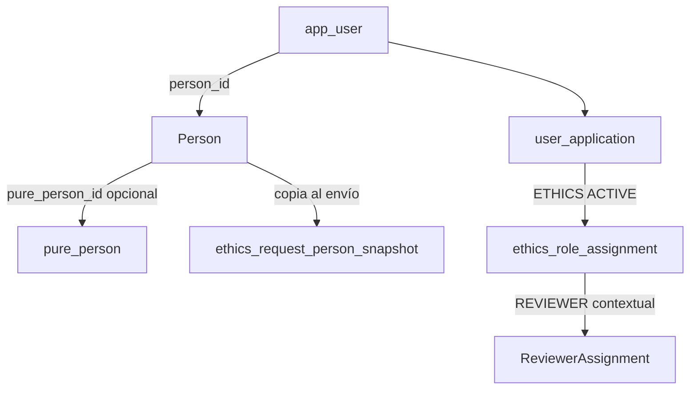

# Persona, cuenta y acceso a Ethics

Ethics no tiene una cuenta propia. OpenScience y Ethics usan la misma cuenta `app_user` y la misma base `uss-ca`. Ethics lee `pure_person` en ese backend. No llama a OpenScience por HTTP y el navegador no consulta PURE.

## Decisiones

- Hay una sola cuenta para OpenScience y Ethics. Nadie crea una segunda cuenta para entrar a Ethics.
- El acceso a cada aplicación es independiente: `OPENSCIENCE` y `ETHICS`, con estado `ACTIVE`, `INACTIVE` o `REVOKED`.
- Un rol de Ethics no concede permisos de OpenScience. `ADMINISTRATOR` de Ethics no es `PLATFORM_ADMIN`.
- Quien obtiene acceso a Ethics por primera vez recibe `RESEARCHER`. Crear o importar una persona no lo concede.
- La persona puede existir sin cuenta. Hace falta para un revisor, patrocinante o tutor que todavía no entra a la plataforma.
- `pure_person_id` nulo significa persona local o externa. Un valor presente la vincula a PURE. El id de la persona compartida sigue siendo `person.id`.
- Si la persona está vinculada, PURE es la fuente autoritativa. Ethics no edita esos datos y no guarda un override local.
- Una persona externa no se inserta en `pure_person` y no se empareja por nombre. Sus datos quedan en `person` y sí se editan.
- El envío formal guarda una copia de la persona. Un cambio posterior en PURE no reescribe esa copia.
- Tener fila en PURE, o ser una persona externa, no concede roles. La autorización sigue en `AuthorizationService`, con `UserApplication`, `ethics_role_assignment` y `ReviewerAssignment`.

## Qué se reutiliza

| Pieza | Uso |
| --- | --- |
| `app_user` | Cuenta compartida. Ya tiene correo, nombre de acceso y estado. |
| `app_user_role` / `app_role` | Roles de OpenScience (`PLATFORM_ADMIN`, `DATA_STEWARD`, …). No se usan para Ethics. |
| `app_module` | Módulos de OpenScience. No es el acceso a una aplicación. |
| `pure_person` | Fuente institucional USS. Ethics solo la lee. |
| `permissions-V4.yml` | Capabilities de Ethics. |
| `demo-role-assignments-V2.yml` | Fixture del prototipo. No autoriza la sesión real. |

No había `user_application` ni una persona compartida distinta de `pure_person` y del directorio USS. `uss_directory_person` es el padrón institucional importado, con RUT y planillas. No representa a una persona externa ni a un override local, así que no se reutiliza como `Person`.

`app_user.first_name` y `app_user.last_name` se quedan: la autenticación ya los exige. El formulario de Ethics no los toma como perfil. El perfil sale de `person` y, si corresponde, de `pure_person`.

## Persona y PURE

Columnas que hoy tiene `pure_person` y que el perfil usa:

| Perfil | Columna |
| --- | --- |
| nombre | `first_name` |
| apellidos | `last_name` |
| correo | `email` |
| cargo | `cargo` |

`pure_person` no tiene sede, facultad, unidad ni programa. Esas propiedades no se inventan ni se infieren por parecido con el catálogo del formulario. `GET /api/v1/ethics/me/profile` las deja vacías. El cargo se envía tal como está en `cargo`. El formulario solo lo precarga si coincide exactamente con una opción de P10.

## PURE-LINKED PERSON

`purePersonId != null`

PURE es la fuente autoritativa. El perfil efectivo es el de `pure_person`, aunque una columna local tenga otro texto. Un atributo institucional vacío se muestra vacío o como «No disponible». No se completa desde Ethics.

Ethics no hace `UPDATE`, `INSERT` ni `DELETE` de `pure_person`. `EthicsAccessService.updateLocalPerson` rechaza el cambio con `PURE_PERSON_READONLY`: «Los datos de esta persona provienen de PURE y no pueden modificarse desde Ética de Proyectos.»

No había filas persistidas de override: el modelo anterior solo existía en memoria, en `PersonProfileResolver`. Esas columnas locales, si una persona vinculada las tuviera, se conservan y no se migran a PURE. Las lecturas nuevas no las usan.

## LOCAL / EXTERNAL PERSON

`purePersonId == null`

Los datos se guardan en `person`. Se pueden editar según el permiso del formulario. No se crea un `purePersonId` ni una fila en `pure_person`.

`PersonProfileResolver` es el único lugar que elige la fuente. Los módulos de Ethics no arman ese join por su cuenta.

El patrocinante y el tutor del formulario de nuevo proyecto son texto libre. No apuntan a un `person`, así que esa regla no los bloquea. Si más adelante se reutiliza `Person`, se aplica la misma distinción.

## Acceso y rol por defecto

`EthicsAccessService.grantEthicsAccess` hace, en este orden:

1. Busca la cuenta. Si no existe, no crea una persona ni un rol.
2. Crea `user_application` `ETHICS` / `ACTIVE` si no hay fila. Si ya hay, no agrega otra.
3. Si la cuenta no tiene `person_id`, reutiliza la persona de ese `pure_person_id` o crea una. Sin id institucional, la persona queda local con el nombre y el correo de la cuenta.
4. Si no hay una asignación `RESEARCHER`, crea una: `GLOBAL`, `*`, `ACTIVE`.

Ejecutarlo otra vez deja una sola fila de acceso y una sola asignación `RESEARCHER`.

El alcance `GLOBAL` / `*` existe porque `ScopeType` todavía no tiene `OWN_PROJECT`. Esa asignación permite a la cuenta actuar como investigador antes de tener un proyecto. No abre los proyectos de otra persona en el prototipo: la interfaz sigue usando `OWN_PROJECT` y `Project.researcherId`. Cuando el repositorio JDBC reemplace al YAML, hay que conservar esa distinción.

`REVIEWER` no sale de ser externo ni de tener `RESEARCHER`. Entra con una asignación `PROCESS` o con `ReviewerAssignment`. Los dos roles se suman solo en el contexto donde cada alcance coincide. Quitar el acceso a Ethics no borra la persona, la cuenta, la revisión ni la copia del envío: pasa esa fila de `user_application` a `REVOKED`.

Revocar Ethics deja OpenScience como estaba, y al revés.

## Qué sigue en demo

`demo-role-assignments-V2.yml` sigue cargándose. `DatabaseRoleAssignmentRepository` no está registrado. Los usuarios del selector no pasan por `grantEthicsAccess`: ya tienen su rol en el prototipo. Sofía no gana un `RESEARCHER` artificial por este modelo.

El alta automática de `RESEARCHER` queda en `EthicsAccessService`, cubierto por `EthicsIdentityTest` y `EthicsRegistrationTest`. La pantalla Administración → Usuarios usa la capability `MANAGE_USERS`. No hay invitación por correo ni sincronización masiva con PURE: el prototipo deja un aviso de acceso, sin contraseña.

El administrador inicial real es `juan.cabello@uss.cl`, configurado en `ethics.bootstrap.adminEmails`. El arranque busca esa cuenta en `app_user` y no crea otra ni otra contraseña. Si existe, deja Ethics activo y los roles `RESEARCHER` y `ADMINISTRATOR`. Camila sigue siendo solo el perfil demo. El script manual está en `backend/sql/ethics-admin-bootstrap.sql`.

## Copia al enviar

`EthicsAccessService.captureSnapshot` copia el perfil efectivo al envío. Una segunda llamada con el mismo `request_id` devuelve la primera copia. Cambiar `pure_person` después no la modifica. El formulario nuevo, en cambio, vuelve a leer el perfil vigente.

En el prototipo, `EthicsSubmission.personSnapshot` se escribe solo en `submit`. Guardar borrador no la crea ni la pisa. Los campos de una persona vinculada se muestran en solo lectura, pero el valor sigue en el formulario y entra en esa copia. Un cambio posterior en PURE no la modifica. El formulario nuevo vuelve a leer el perfil vigente.

Juan Pérez (`u-inv-1`) tiene `purePersonId` 10 y tipo institucional. No se infiere por `@uss.cl`. Alberto Soto es el revisor externo de demostración: persona local, `purePersonId` nulo, acceso Ethics y sin `RESEARCHER`. La clave local del prototipo pasó a `ethics-uss-store-v11`.

## Alta, investigadores y revisores externos

Todos los investigadores de Ethics son institucionales USS. No existe investigador externo ni el rol `EXTERNAL_REVIEWER`.

El autoregistro solo acepta el dominio completo, sin distinguir mayúsculas, de `uss.cl`, `correo.uss.cl` y `docente.uss.cl`. La misma regla está en `InstitutionalDomains` y en `isAllowedInstitutionalEmail`. Un correo de otro dominio no crea cuenta. Un revisor externo lo incorpora Administración.

Ethics muestra su propio formulario de acceso y no envía a la pantalla de OpenScience. El formulario llama al login común y reutiliza `OS_SESSION`. Quien ya tiene esa cookie entra sin volver a escribir la contraseña. Quien ya tiene cuenta en OpenScience o Eventos reutiliza esa cuenta y esa contraseña. La primera entrada institucional habilita `ETHICS` y asigna `RESEARCHER` una sola vez. Un correo externo, aunque ya tenga cuenta activa en OpenScience o Eventos y una sesión válida, no recibe Ethics, ni `RESEARCHER`, ni `REVIEWER`, hasta que Administración lo habilite como revisor externo. Esa entrada responde `403 ETHICS_ACCESS_DENIED` y no muestra una acción para autohabilitarse.

`Person.kind` distingue `INSTITUTIONAL` de `EXTERNAL`. Una persona institucional puede no tener `purePersonId`. Si lo tiene, PURE es de solo lectura. Deshabilitar Ethics no borra la cuenta, la persona, las revisiones históricas ni el acceso a Eventos u OpenScience.

Si el revisor tiene una asignación activa, deshabilitar Ethics exige confirmación y no reasigna la revisión.

## Pendiente

- Ejecutar `backend/sql/proposed-person-user.sql` en `uss-ca`.
- Registrar el repositorio JDBC y exigir `user_application` `ETHICS` / `ACTIVE` dentro de `AuthorizationService` cuando la cuenta ya tenga filas de acceso. Las cuentas que solo existen en el YAML demo siguen autorizándose como hasta ahora.
- Traducir sede, facultad y programa cuando exista una correspondencia inequívoca con el formulario.
- El envío real del correo de habilitación queda pendiente: no hay servicio de correo en Ethics. El aviso queda registrado y no incluye contraseña.
- La escritura hacia PURE queda fuera.
